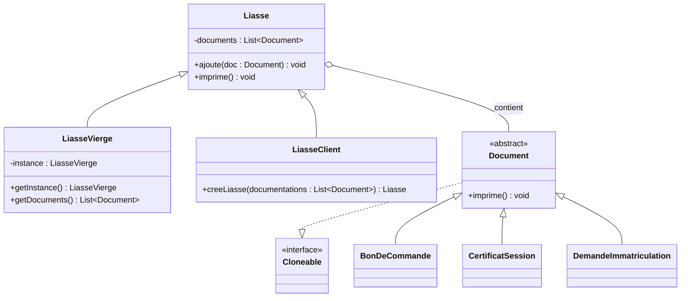

# Singleton Pattern

Le patron Singleton est un patron de création qui permet de garantir qu'une
classe ne possède qu'une seule instance et de fournir un point d'accès global
à cette instance.

## Utilisation

Ce patron est utile lorsqu'une seule instance d'une classe est nécessaire, par
exemple pour contrôler l'accès à une ressource partagée.

## Architecture UML

### Rôle des classes

- **Liasse** : classe de base qui agrège les documents.
- **LiasseVierge** : singleton dérivé de `Liasse` qui contient la liste de
  documents types.
- **LiasseClient** : classe dérivée de `Liasse` pour représenter la liasse d'un
  client.
- **Document** et ses sous-classes : représentent les documents imprimables.
